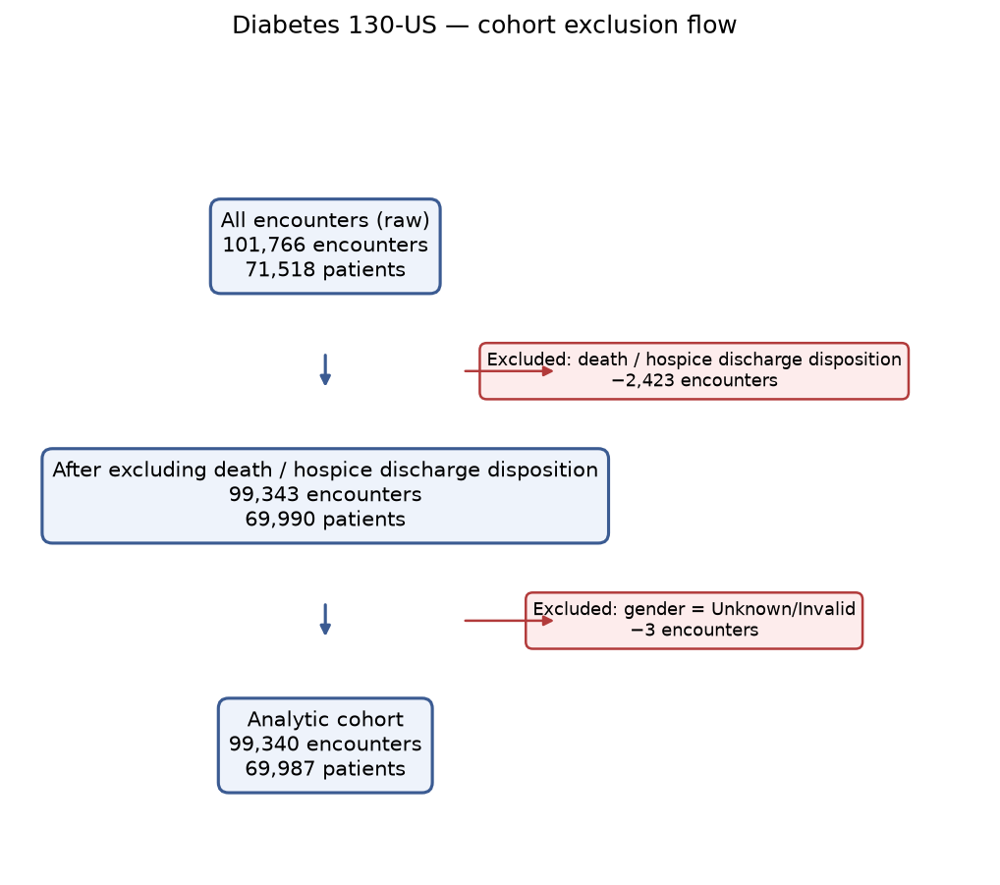
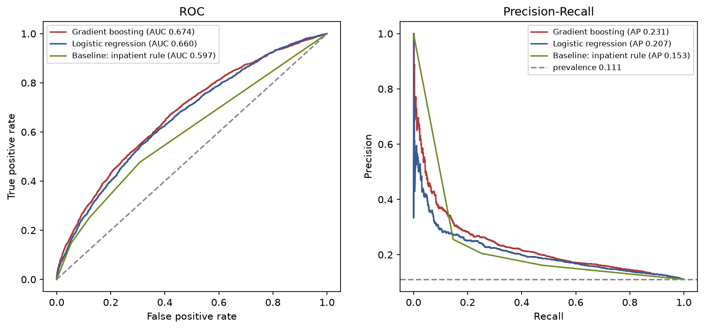

# Predicting 30-day hospital readmission in patients with diabetes

An independent, reproducible portfolio project on the UCI **Diabetes 130-US
Hospitals (1999–2008)** dataset. At the moment of discharge, it estimates the
probability that a patient with diabetes is readmitted within 30 days, and studies
which patient and treatment characteristics are associated with that outcome.

> **The point of this project is methodological honesty** — a correctly defined
> cohort, no data leakage, patient-level evaluation, honest comparison with simple
> baselines, calibrated probabilities, and clearly stated limitations — **not** a
> high ROC-AUC.

## Key results (held-out test set, 95% patient-cluster bootstrap CIs)

| model | ROC-AUC | PR-AUC | Brier |
| --- | --- | --- | --- |
| Baseline: constant prevalence | 0.500 | 0.111 | 0.098 |
| Baseline: prior-inpatient-visits rule | 0.597 (0.583–0.611) | 0.153 | 0.096 |
| Logistic regression (L2) | 0.660 (0.646–0.674) | 0.207 | 0.095 |
| **Gradient boosting** | **0.674 (0.660–0.688)** | **0.231** | **0.094** |

The models beat the no-information baseline and **modestly** beat a simple
"more past admissions → higher risk" rule (ΔROC-AUC ≈ 0.08, CI excludes 0). This is
an honest, expected result for this dataset. Probabilities are close to calibrated
(slight over-prediction). The strongest predictors are prior inpatient visits and
discharge disposition.




Full write-up: [`reports/model_report.md`](reports/model_report.md). Evaluation
detail (thresholds, subgroups, calibration, permutation importance, sensitivity
analysis): [`reports/evaluation_report.md`](reports/evaluation_report.md).

## Data and licence

- **Source:** UCI Machine Learning Repository, *Diabetes 130-US Hospitals for Years
  1999–2008* (dataset id 296), licence **CC BY 4.0**.
  <https://archive.ics.uci.edu/dataset/296> · DOI: 10.24432/C5230J
- Raw data is **not** committed (`data/` is gitignored); only
  `data/raw/MANIFEST.json` (source URL + SHA-256 + date) is tracked.
  `python -m src.data.download` fetches it (direct UCI zip, with a `ucimlrepo`
  fallback) and verifies the manifest.

**Please cite:**
- Clore, J., Cios, K., DeShazo, J., & Strack, B. (2014). *Diabetes 130-US Hospitals
  for Years 1999–2008.* UCI Machine Learning Repository.
- Strack, B. et al. (2014). *Impact of HbA1c Measurement on Hospital Readmission
  Rates: Analysis of 70,000 Clinical Database Patient Records.* BioMed Research
  International.

## Cohort and target

- Rows are **encounters, not patients** (101,766 encounters of 71,518 patients).
- **Target:** `y = 1` if `readmitted == "<30"`, else `0` (`">30"` and `"NO"` → 0).
- **Exclusions (frozen before modelling):** death/hospice discharge dispositions
  (−2,423 encounters) and `gender = Unknown/Invalid` (−3).
- **Analytic cohort: 99,340 encounters / 69,987 patients; 11,314 positives
  (11.39%).** Details: [`docs/cohort_definition.md`](docs/cohort_definition.md).

## Methods

- **No leakage:** every split is grouped by `patient_nbr`. Hold-out
  `GroupShuffleSplit` (80/20); inside train, `StratifiedGroupKFold` (5 folds) for
  tuning and threshold selection. All learned preprocessing is fit on train folds
  only. Guards in [`tests/test_leakage.py`](tests/test_leakage.py).
- **Models:** two baselines, L2 logistic regression (odds ratios in
  `reports/odds_ratios.md`), and `HistGradientBoostingClassifier`. ~11% positives
  are kept **without** oversampling so probabilities stay calibration-ready.
- **Evaluation:** ROC-AUC, PR-AUC, Brier, calibration (intercept/slope), and
  operating points chosen on the train CV — all with **patient-cluster bootstrap**
  95% CIs.
- **Decision log:** [`docs/decisions.md`](docs/decisions.md).

## How to run

One command runs the whole pipeline (download → DuckDB load → quality audit →
cohort → EDA → splits → train → evaluate → dashboard export):

**macOS / Linux (zsh/bash):**
```bash
python3 -m venv .venv
source .venv/bin/activate
pip install -e ".[dev]"
python run_pipeline.py
```

**Windows (PowerShell):**
```powershell
py -3.14 -m venv .venv
.venv\Scripts\Activate.ps1   # if blocked: Set-ExecutionPolicy -Scope CurrentUser RemoteSigned
pip install -e ".[dev]"
python run_pipeline.py
```

Run the tests and linter:
```bash
pytest
ruff check .
```

Python 3.14 is used here; `lightgbm` is intentionally avoided (no 3.14 wheel) in
favour of `HistGradientBoostingClassifier`. The pipeline is cross-platform
(`pathlib`, explicit UTF-8, `eol=lf`); CI runs on Ubuntu, Windows and macOS.

## Repository structure

```
run_pipeline.py            one-command pipeline
config/config.yaml         seeds, split sizes, paths, thresholds
sql/                       DuckDB load + quality + cohort queries
src/data/                  download, load, quality audit, cohort
src/features/              icd9_groups (tested), feature schema
src/models/                baselines, splits, leak-safe pipeline, training
src/evaluation/            metrics, cluster bootstrap, thresholds, subgroups
src/export/                Power BI star-schema export + Plotly preview
reports/                   data_quality / eda / model / evaluation reports + figures
dashboard/                 data/ CSVs, DATA_DICTIONARY.md, POWERBI_SPEC.md
docs/                      PLAN, cohort_definition, decisions
tests/                     unit tests + synthetic fixtures (CI needs no download)
```

## Dashboard

A Power BI **data model and build specification** are ready in
[`dashboard/`](dashboard/) (star-schema CSVs + `DATA_DICTIONARY.md` +
`POWERBI_SPEC.md` with DAX measures and four pages). A cross-platform preview is
the self-contained [`reports/dashboard_preview.html`](reports/dashboard_preview.html)
(opens in any browser). **Power BI dashboard: data model and specification ready;
`.pbix` and screenshots — coming soon.** _TODO: add `dashboard/readmission_dashboard.pbix`
and `dashboard/screenshots/`._

## Limitations

- US hospital data from **1999–2008**; treatment practice has since changed.
- **No dates:** `encounter_id` is used only as an assumed chronological order.
- Readmissions to hospitals **outside the recorded network are not observed** — the
  outcome is partly censored.
- High missingness in some features (`weight` dropped; `payer_code`,
  `medical_specialty` kept as an explicit `Missing` category). `payer_code` is an
  administrative/socioeconomic proxy, not a clinical variable.
- **Observational data:** all associations are non-causal.
- Transportability to Germany/Europe is **unverified**; no external or prospective
  validation. Subgroup results are a robustness check, not a fairness audit.

## Disclaimer

This is an **independent portfolio project**, not a clinical tool. It has not been
deployed, used in hospitals, clinically validated, or shown to reduce readmissions.
It is built on historical US data (1999–2008) and must not be used for clinical
decision-making.

## References

See the two citations under **Data and licence** above. Dataset licensed CC BY 4.0.
