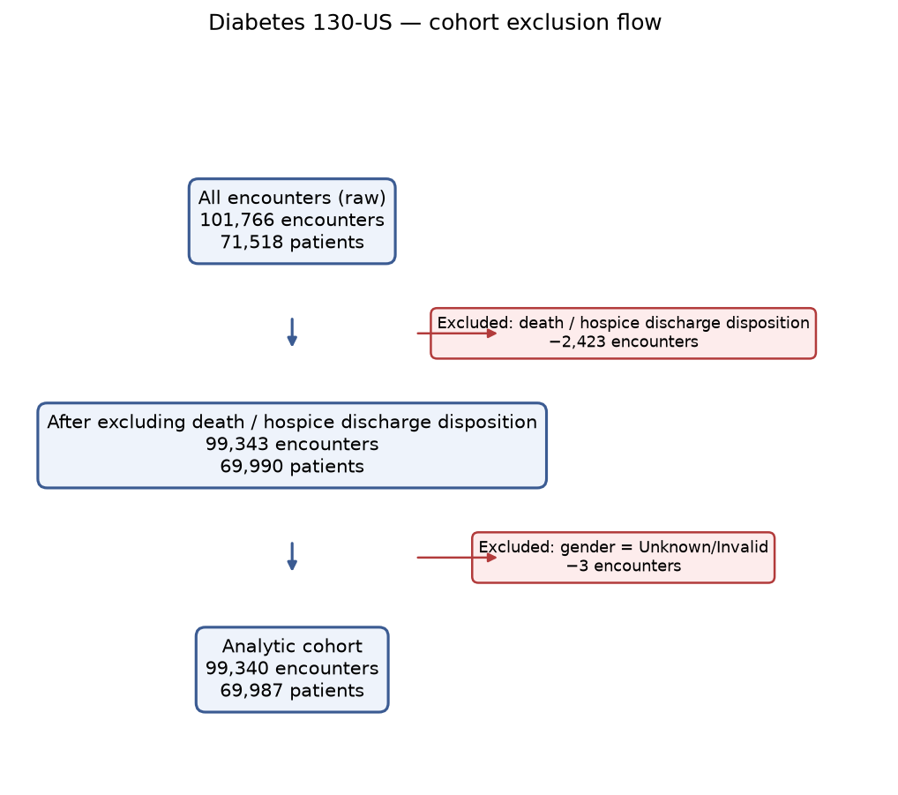

# Cohort definition — frozen before modelling (Stage 2)

This document fixes the cohort, the unit of observation, and the target variable
**before** any model is trained. Numbers are produced by `src/data/cohort.py`
(table `reports/cohort_flow.md`, figure `reports/figures/exclusion_flow.png`) and
are reproducible via `python -m src.data.cohort`.

## 1. Unit of observation

Rows in `diabetic_data.csv` are **hospital encounters, not unique patients**
(101,766 encounters vs 71,518 patients). One patient may have several encounters.

- **Primary analysis:** *all eligible encounters*. To avoid information leaking
  between a patient's own encounters, every train/test split and cross-validation
  fold is grouped by `patient_nbr` (Stage 4).
- **Sensitivity analysis:** *one encounter per patient* — the first by ascending
  `encounter_id` (flagged as `is_first_encounter` in the `cohort` table). This
  checks that conclusions are not driven by patients who are over-represented
  because they were admitted many times.

`encounter_id` is used only as an **assumed** chronological order (the dataset has
no dates); this assumption is listed in Limitations.

## 2. Target variable

```
y = 1  if readmitted == "<30"      (readmitted within 30 days)
y = 0  otherwise                   (readmitted ">30"  OR  "NO")
```

Rationale for collapsing `">30"` into `0`: the clinical and operational question
is specifically **early (30-day) readmission**, the outcome that quality programmes
and discharge planning target. A later readmission is not that outcome, so it is
grouped with "no early readmission". A single, clearly stated target is used
throughout — no relabeling between stages.

## 3. Inclusion / exclusion criteria

**Included:** every encounter in the dataset by default (all ages, both recorded
sexes, all admission types), subject to the exclusions below.

**Excluded, in order:**

1. **Death / hospice discharge.** `discharge_disposition_id ∈ {11, 13, 14, 19,
   20, 21}` — verified against `IDS_mapping.csv` (11 = Expired, 13 = Hospice/home,
   14 = Hospice/medical facility, 19/20 = Expired… hospice; 21 = Expired, place
   unknown, 0 encounters). A 30-day readmission is impossible or meaningless for
   these patients, and keeping them would bias the outcome. **−2,423 encounters**
   (1,528 patients fully removed).
2. **`gender == "Unknown/Invalid"`.** Three encounters with an uninterpretable
   sex value. **−3 encounters.**

### Exclusion flow (CONSORT-style)

| step | encounters | patients |
| --- | ---: | ---: |
| All encounters (raw) | 101,766 | 71,518 |
| After excluding death / hospice discharge | 99,343 | 69,990 |
| After excluding gender = Unknown/Invalid | **99,340** | **69,987** |



**Analytic cohort: 99,340 encounters from 69,987 patients.**
Positives (`y = 1`): **11,314 (11.39%)** — the prevalence used as the constant
baseline in Stage 5.

## 4. Considered but NOT applied (with reasons)

- **Keeping one encounter per patient as the primary unit** (as in Strack et al.
  2014). Rejected as *primary* because it discards most of the data; instead it is
  the sensitivity analysis. Patient-level splitting handles the dependence.
- **Excluding discharges to another hospital / "still patient" (`id` 2, 9, 12,
  etc.).** Not excluded: these patients can still be readmitted within 30 days, so
  the outcome is defined for them. Noted here for transparency.
- **Excluding `Unknown/Invalid` / `Not Mapped` discharge dispositions (25, 26).**
  Kept (outcome still defined); treated as ordinary categories in features.

## 5. What is frozen

The exclusion list, their order, the target definition, and the unit of
observation above are fixed for all subsequent stages. Any change would be logged
in `docs/decisions.md` with a reason and would trigger a re-run from Stage 2.
