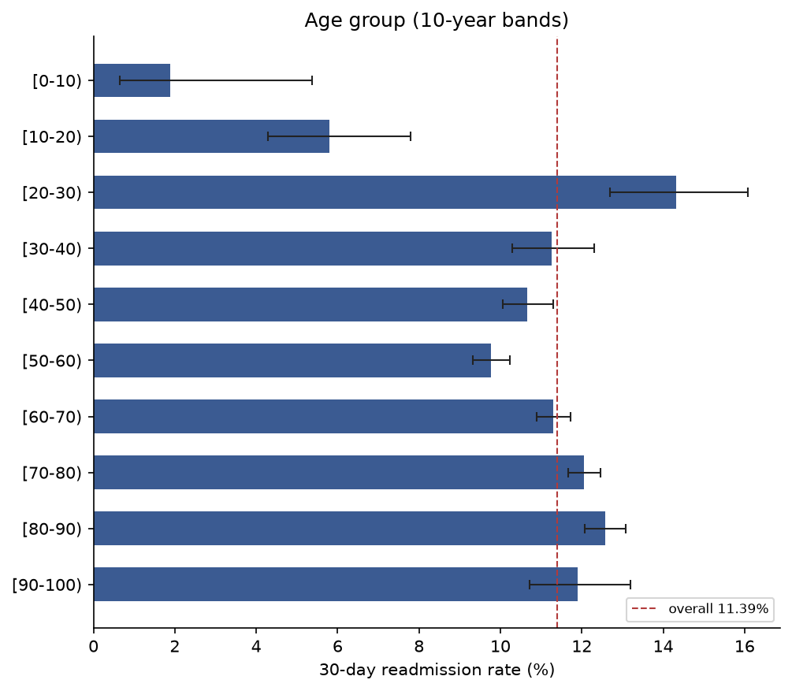
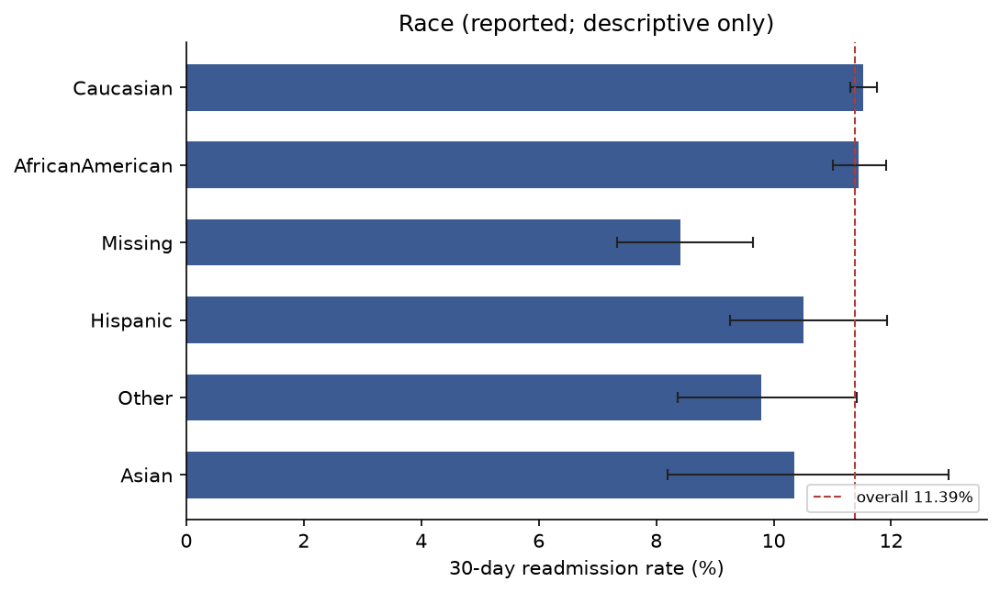
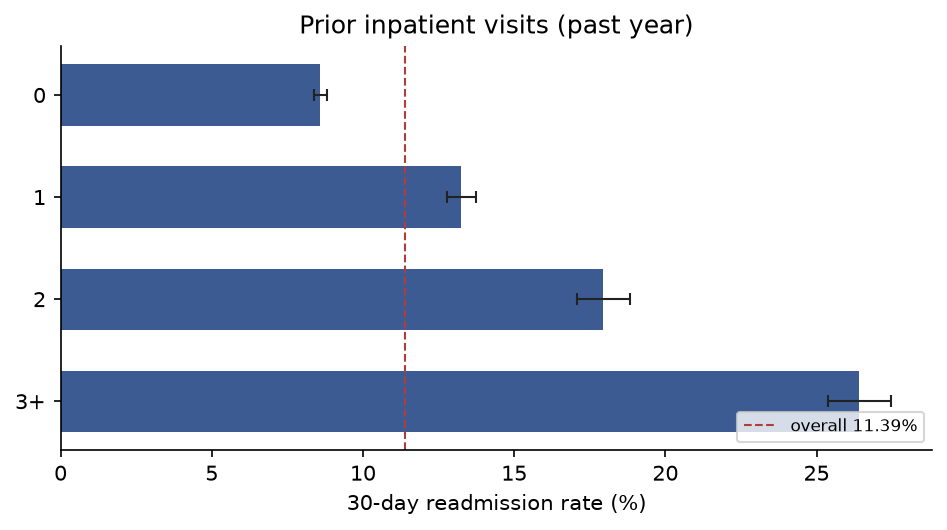
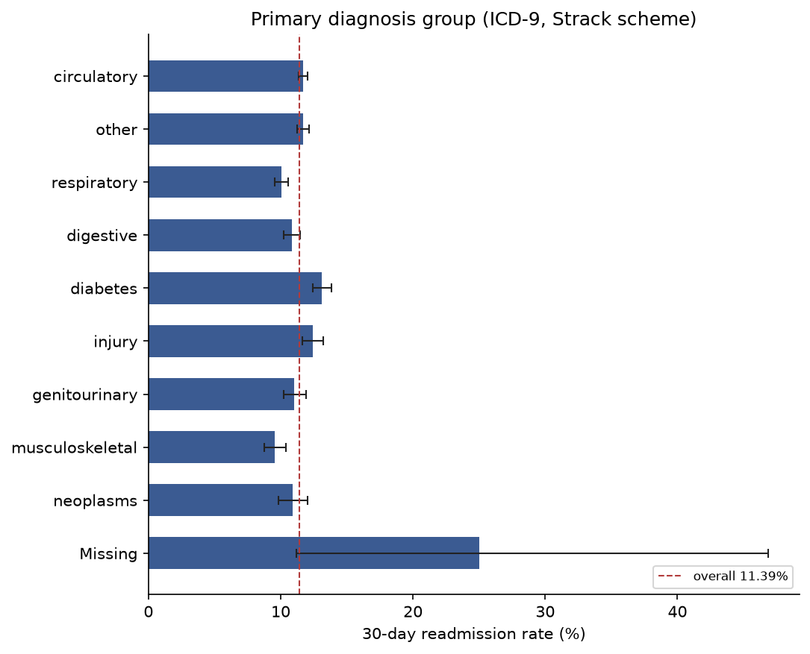
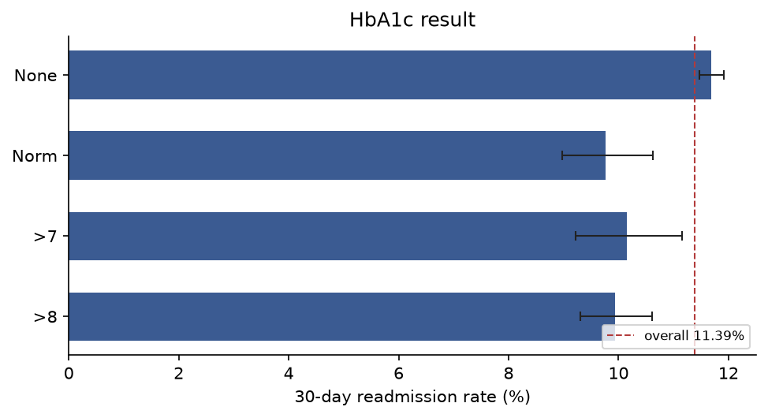

# Exploratory analysis — 30-day readmission (Stage 3)

Cohort: **99,340 encounters** (from the frozen Stage 2 cohort). Overall 30-day readmission rate: **11.39%**.

Each table shows, per category, the number of encounters `n`, the number readmitted within 30 days `n(<30)`, the rate, and a 95% Wilson confidence interval. **These are descriptive associations, not causal effects**, and do not adjust for confounding or for repeated encounters of the same patient.

## Age group (10-year bands)

| category | n | n(<30) | rate % | 95% CI low | 95% CI high |
| --- | ---: | ---: | ---: | ---: | ---: |
| [0-10) | 160 | 3 | 1.88 | 0.64 | 5.37 |
| [10-20) | 690 | 40 | 5.8 | 4.29 | 7.8 |
| [20-30) | 1,649 | 236 | 14.31 | 12.7 | 16.08 |
| [30-40) | 3,764 | 424 | 11.26 | 10.29 | 12.31 |
| [40-50) | 9,607 | 1,024 | 10.66 | 10.06 | 11.29 |
| [50-60) | 17,060 | 1,667 | 9.77 | 9.33 | 10.23 |
| [60-70) | 22,058 | 2,493 | 11.3 | 10.89 | 11.73 |
| [70-80) | 25,329 | 3,054 | 12.06 | 11.66 | 12.46 |
| [80-90) | 16,434 | 2,065 | 12.57 | 12.07 | 13.08 |
| [90-100) | 2,589 | 308 | 11.9 | 10.71 | 13.2 |

## Sex

| category | n | n(<30) | rate % | 95% CI low | 95% CI high |
| --- | ---: | ---: | ---: | ---: | ---: |
| Female | 53,454 | 6,128 | 11.46 | 11.2 | 11.74 |
| Male | 45,886 | 5,186 | 11.3 | 11.02 | 11.59 |

## Race (reported; descriptive only)

| category | n | n(<30) | rate % | 95% CI low | 95% CI high |
| --- | ---: | ---: | ---: | ---: | ---: |
| Caucasian | 74,220 | 8,556 | 11.53 | 11.3 | 11.76 |
| AfricanAmerican | 18,772 | 2,149 | 11.45 | 11.0 | 11.91 |
| Missing | 2,232 | 188 | 8.42 | 7.34 | 9.65 |
| Hispanic | 2,017 | 212 | 10.51 | 9.25 | 11.93 |
| Other | 1,471 | 144 | 9.79 | 8.37 | 11.41 |
| Asian | 628 | 65 | 10.35 | 8.2 | 12.98 |

## Length of stay

| category | n | n(<30) | rate % | 95% CI low | 95% CI high |
| --- | ---: | ---: | ---: | ---: | ---: |
| 1-3 days | 48,145 | 4,747 | 9.86 | 9.6 | 10.13 |
| 4-6 days | 30,788 | 3,783 | 12.29 | 11.93 | 12.66 |
| 7-9 days | 12,845 | 1,781 | 13.87 | 13.28 | 14.47 |
| 10-14 days | 7,562 | 1,003 | 13.26 | 12.52 | 14.05 |

## Prior inpatient visits (past year)

| category | n | n(<30) | rate % | 95% CI low | 95% CI high |
| --- | ---: | ---: | ---: | ---: | ---: |
| 0 | 66,242 | 5,690 | 8.59 | 8.38 | 8.81 |
| 1 | 18,984 | 2,516 | 13.25 | 12.78 | 13.74 |
| 2 | 7,300 | 1,309 | 17.93 | 17.07 | 18.83 |
| 3+ | 6,814 | 1,799 | 26.4 | 25.37 | 27.46 |

## Prior emergency visits (past year)

| category | n | n(<30) | rate % | 95% CI low | 95% CI high |
| --- | ---: | ---: | ---: | ---: | ---: |
| 0 | 88,246 | 9,431 | 10.69 | 10.49 | 10.89 |
| 1 | 7,474 | 1,097 | 14.68 | 13.89 | 15.5 |
| 2+ | 3,620 | 786 | 21.71 | 20.4 | 23.09 |

## Prior outpatient visits (past year)

| category | n | n(<30) | rate % | 95% CI low | 95% CI high |
| --- | ---: | ---: | ---: | ---: | ---: |
| 0 | 82,991 | 9,039 | 10.89 | 10.68 | 11.11 |
| 1 | 8,349 | 1,186 | 14.21 | 13.47 | 14.97 |
| 2+ | 8,000 | 1,089 | 13.61 | 12.88 | 14.38 |

## Number of diagnoses

| category | n | n(<30) | rate % | 95% CI low | 95% CI high |
| --- | ---: | ---: | ---: | ---: | ---: |
| 1-4 | 9,562 | 741 | 7.75 | 7.23 | 8.3 |
| 5-7 | 31,501 | 3,206 | 10.18 | 9.85 | 10.52 |
| 8 | 10,359 | 1,249 | 12.06 | 11.44 | 12.7 |
| 9 | 47,809 | 6,101 | 12.76 | 12.47 | 13.06 |
| 10-16 | 109 | 17 | 15.6 | 9.97 | 23.56 |

## Primary diagnosis group (ICD-9, Strack scheme)

| category | n | n(<30) | rate % | 95% CI low | 95% CI high |
| --- | ---: | ---: | ---: | ---: | ---: |
| circulatory | 29,680 | 3,469 | 11.69 | 11.33 | 12.06 |
| other | 17,793 | 2,079 | 11.68 | 11.22 | 12.16 |
| respiratory | 13,934 | 1,402 | 10.06 | 9.57 | 10.57 |
| digestive | 9,333 | 1,010 | 10.82 | 10.21 | 11.47 |
| diabetes | 8,661 | 1,135 | 13.1 | 12.41 | 13.83 |
| injury | 6,851 | 850 | 12.41 | 11.65 | 13.21 |
| genitourinary | 5,002 | 552 | 11.04 | 10.2 | 11.93 |
| musculoskeletal | 4,935 | 471 | 9.54 | 8.76 | 10.4 |
| neoplasms | 3,131 | 341 | 10.89 | 9.85 | 12.03 |
| Missing | 20 | 5 | 25.0 | 11.19 | 46.87 |

## Insulin

| category | n | n(<30) | rate % | 95% CI low | 95% CI high |
| --- | ---: | ---: | ---: | ---: | ---: |
| No | 46,376 | 4,736 | 10.21 | 9.94 | 10.49 |
| Down | 11,908 | 1,693 | 14.22 | 13.6 | 14.86 |
| Steady | 30,069 | 3,420 | 11.37 | 11.02 | 11.74 |
| Up | 10,987 | 1,465 | 13.33 | 12.71 | 13.98 |

## Any change in diabetes medication

| category | n | n(<30) | rate % | 95% CI low | 95% CI high |
| --- | ---: | ---: | ---: | ---: | ---: |
| No | 53,220 | 5,769 | 10.84 | 10.58 | 11.11 |
| Ch | 46,120 | 5,545 | 12.02 | 11.73 | 12.32 |

## On any diabetes medication

| category | n | n(<30) | rate % | 95% CI low | 95% CI high |
| --- | ---: | ---: | ---: | ---: | ---: |
| No | 22,623 | 2,233 | 9.87 | 9.49 | 10.27 |
| Yes | 76,717 | 9,081 | 11.84 | 11.61 | 12.07 |

## HbA1c result

| category | n | n(<30) | rate % | 95% CI low | 95% CI high |
| --- | ---: | ---: | ---: | ---: | ---: |
| None | 82,506 | 9,641 | 11.69 | 11.47 | 11.91 |
| Norm | 4,922 | 481 | 9.77 | 8.97 | 10.63 |
| >7 | 3,775 | 383 | 10.15 | 9.22 | 11.15 |
| >8 | 8,137 | 809 | 9.94 | 9.31 | 10.61 |

## Admission type

| category | n | n(<30) | rate % | 95% CI low | 95% CI high |
| --- | ---: | ---: | ---: | ---: | ---: |
| Emergency | 52,369 | 6,194 | 11.83 | 11.55 | 12.11 |
| Elective | 18,667 | 1,958 | 10.49 | 10.06 | 10.94 |
| Urgent | 18,132 | 2,058 | 11.35 | 10.9 | 11.82 |
| NULL | 5,207 | 583 | 11.2 | 10.37 | 12.08 |
| Not Available | 4,617 | 493 | 10.68 | 9.82 | 11.6 |
| Not Mapped | 320 | 27 | 8.44 | 5.86 | 12.0 |
| Trauma Center | 18 | 0 | 0.0 | 0.0 | 17.59 |
| Newborn | 10 | 1 | 10.0 | 1.79 | 40.42 |

## Discharge disposition (top 12)

| category | n | n(<30) | rate % | 95% CI low | 95% CI high |
| --- | ---: | ---: | ---: | ---: | ---: |
| Discharged to home | 60,232 | 5,602 | 9.3 | 9.07 | 9.54 |
| Discharged/transferred to SNF | 13,954 | 2,046 | 14.66 | 14.09 | 15.26 |
| Discharged/transferred to home with home health service | 12,902 | 1,638 | 12.7 | 12.13 | 13.28 |
| NULL | 3,691 | 459 | 12.44 | 11.41 | 13.54 |
| Discharged/transferred to another short term hospital | 2,128 | 342 | 16.07 | 14.57 | 17.69 |
| Discharged/transferred to another rehab fac including rehab units of a hospital . | 1,992 | 552 | 27.71 | 25.79 | 29.72 |
| Discharged/transferred to another type of inpatient care institution | 1,184 | 247 | 20.86 | 18.64 | 23.27 |
| Not Mapped | 989 | 92 | 9.3 | 7.65 | 11.27 |
| Discharged/transferred to ICF | 815 | 104 | 12.76 | 10.64 | 15.23 |
| Left AMA | 623 | 90 | 14.45 | 11.9 | 17.42 |
| Discharged/transferred to a long term care hospital. | 412 | 30 | 7.28 | 5.15 | 10.2 |
| Discharged/transferred/referred to a psychiatric hospital of psychiatric distinct part unit of a hospital | 139 | 51 | 36.69 | 29.14 | 44.96 |
