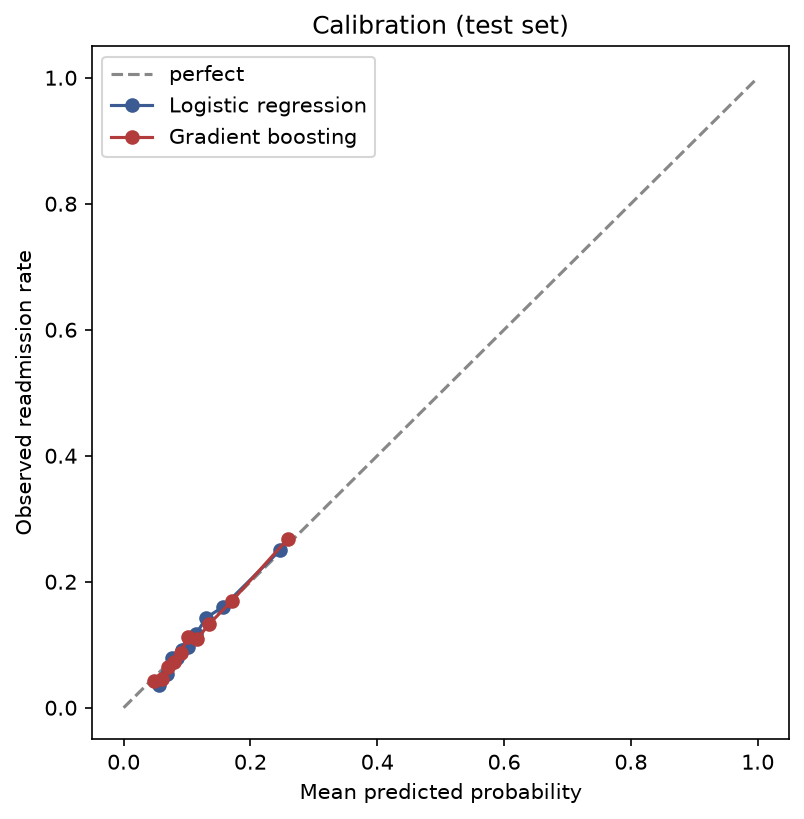
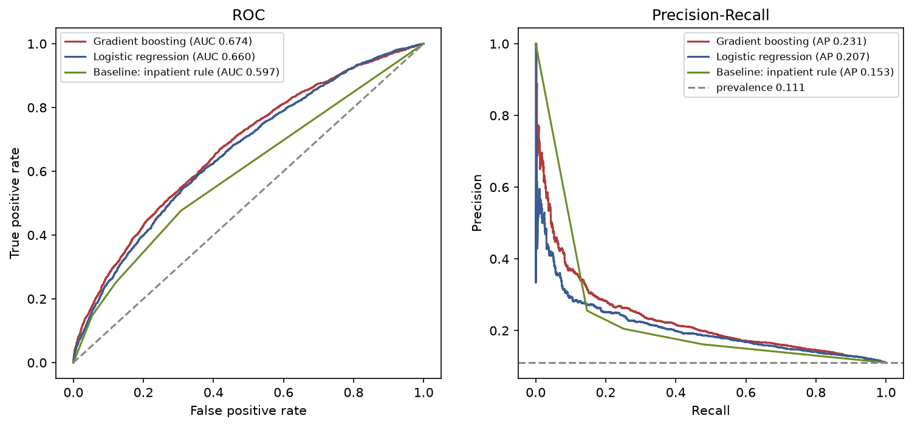

# Hold-out evaluation report (Stage 6)

Final evaluation on the held-out test set (never used for training or threshold selection). All uncertainty intervals are 95% patient-cluster bootstrap CIs (1,000 replicates).

## 1. Discrimination and overall accuracy (test set)

Test set: **19,658 encounters** from **13,998 patients**, positive rate **11.06%** (PR-AUC no-skill reference).
95% CIs from 1,000 patient-cluster bootstrap replicates.

| model | ROC-AUC | PR-AUC | Brier |
| --- | --- | --- | --- |
| Baseline: prevalence | 0.5000 (0.5000–0.5000) | 0.1106 (0.1063–0.1157) | 0.0984 (0.0951–0.1023) |
| Baseline: inpatient rule | 0.5965 (0.5830–0.6106) | 0.1532 (0.1421–0.1659) | 0.0964 (0.0932–0.1001) |
| Logistic regression | 0.6601 (0.6459–0.6739) | 0.2068 (0.1894–0.2277) | 0.0946 (0.0915–0.0982) |
| Gradient boosting | 0.6738 (0.6598–0.6879) | 0.2308 (0.2119–0.2523) | 0.0935 (0.0904–0.0970) |

## 2. Model vs baseline — ROC-AUC difference (paired bootstrap)

| comparison | ΔROC-AUC (95% CI) |
| --- | --- |
| Gradient boosting - inpatient rule | 0.0773 (0.0670–0.0869) |
| Logistic regression - inpatient rule | 0.0636 (0.0527–0.0741) |
| Gradient boosting - logistic regression | 0.0138 (0.0089–0.0190) |

A CI that excludes 0 indicates a difference beyond sampling noise under the patient-cluster bootstrap.

## 3. Calibration (test set)

Cox calibration: fit of the outcome on the logit of the predicted probability. Ideal is intercept 0 and slope 1.

| model | calibration intercept | calibration slope |
| --- | ---: | ---: |
| Logistic regression | 0.168 | 1.097 |
| Gradient boosting | 0.173 | 1.102 |

## 4. ROC and Precision-Recall curves

## 5. Operating points (thresholds chosen on train CV, applied to test)

Per 1,000 discharges, how many are flagged high-risk and the trade-offs. Thresholds are selected on the training out-of-fold predictions, never on test.

### Gradient boosting

| operating_point | threshold | flagged | flagged_per_1000 | sensitivity | specificity | ppv | npv | tp | fp | tn | fn |
| --- | --- | --- | --- | --- | --- | --- | --- | --- | --- | --- | --- |
| top10 (highest-risk 10%) | 0.1954 | 1967 | 100.1 | 0.242 | 0.918 | 0.268 | 0.907 | 527 | 1440 | 16043 | 1648 |
| top20 (highest-risk 20%) | 0.151 | 3868 | 196.8 | 0.393 | 0.828 | 0.221 | 0.916 | 854 | 3014 | 14469 | 1321 |
| sens~50% | 0.1286 | 5392 | 274.3 | 0.488 | 0.752 | 0.197 | 0.922 | 1062 | 4330 | 13153 | 1113 |

### Logistic regression

| operating_point | threshold | flagged | flagged_per_1000 | sensitivity | specificity | ppv | npv | tp | fp | tn | fn |
| --- | --- | --- | --- | --- | --- | --- | --- | --- | --- | --- | --- |
| top10 (highest-risk 10%) | 0.1792 | 1942 | 98.8 | 0.221 | 0.916 | 0.248 | 0.904 | 481 | 1461 | 16022 | 1694 |
| top20 (highest-risk 20%) | 0.1414 | 3875 | 197.1 | 0.368 | 0.824 | 0.206 | 0.913 | 800 | 3075 | 14408 | 1375 |
| sens~50% | 0.1221 | 5826 | 296.4 | 0.495 | 0.728 | 0.185 | 0.921 | 1076 | 4750 | 12733 | 1099 |

## 6. Subgroup performance — gradient boosting (robustness check, not a fairness audit)

ROC-AUC and calibration within subgroups; subgroups with < 100 encounters or a single outcome class are reported with their size only. Interpret cautiously.

### Age group

| subgroup | n | positive_pct | roc_auc | calib_intercept | calib_slope |
| --- | --- | --- | --- | --- | --- |
| [70-80) | 5125 | 12.02 | 0.6538 | 0.091 | 1.043 |
| [60-70) | 4341 | 10.3 | 0.6499 | -0.026 | 1.023 |
| [50-60) | 3380 | 9.79 | 0.7278 | 0.578 | 1.309 |
| [80-90) | 3267 | 12.79 | 0.6239 | -0.166 | 0.895 |
| [40-50) | 1880 | 10.43 | 0.7224 | 0.486 | 1.296 |
| [30-40) | 694 | 10.52 | 0.7237 | 0.195 | 1.082 |
| [90-100) | 527 | 12.14 | 0.5846 | -0.534 | 0.728 |
| [20-30) | 270 | 8.52 | 0.7249 | 0.033 | 1.111 |
| [10-20) | 143 | 4.9 | 0.4685 | -1.22 | 0.681 |
| [0-10) | 31 | 0.0 |  |  |  |

### Sex

| subgroup | n | positive_pct | roc_auc | calib_intercept | calib_slope |
| --- | --- | --- | --- | --- | --- |
| Female | 10545 | 10.98 | 0.6758 | 0.122 | 1.092 |
| Male | 9113 | 11.16 | 0.672 | 0.246 | 1.119 |

### Race

| subgroup | n | positive_pct | roc_auc | calib_intercept | calib_slope |
| --- | --- | --- | --- | --- | --- |
| Caucasian | 14650 | 11.36 | 0.6707 | 0.209 | 1.106 |
| AfricanAmerican | 3682 | 10.21 | 0.672 | -0.115 | 1.011 |
| Missing | 470 | 6.6 | 0.6344 | -0.404 | 0.976 |
| Hispanic | 447 | 12.75 | 0.7776 | 1.21 | 1.628 |
| Other | 295 | 12.88 | 0.665 | 0.179 | 0.991 |
| Asian | 114 | 7.89 | 0.6772 | 0.085 | 1.16 |

## 7. Permutation importance — gradient boosting (test set)

Drop in test ROC-AUC when a feature's values are shuffled (mean over 5 repeats). Importance reflects predictive contribution, not causation.

| feature | mean ROC-AUC drop | std |
| --- | ---: | ---: |
| number_inpatient | 0.0714 | 0.0031 |
| discharge_disposition_id | 0.0576 | 0.0039 |
| diag_1_group | 0.0046 | 0.0010 |
| payer_code | 0.0040 | 0.0007 |
| time_in_hospital | 0.0037 | 0.0008 |
| number_emergency | 0.0037 | 0.0004 |
| age | 0.0028 | 0.0009 |
| number_diagnoses | 0.0028 | 0.0005 |
| medical_specialty | 0.0026 | 0.0007 |
| diabetesMed | 0.0023 | 0.0007 |
| admission_source_id | 0.0021 | 0.0004 |
| admission_type_id | 0.0020 | 0.0003 |
| diag_3_group | 0.0018 | 0.0008 |
| num_medications | 0.0014 | 0.0010 |
| num_lab_procedures | 0.0006 | 0.0005 |

## 8. Sensitivity analysis — one (first) encounter per patient

Restricting the test set to first encounters: **13,998 encounters** from 13,998 patients, positive rate 8.87%.

| model | ROC-AUC | PR-AUC | Brier |
| --- | --- | --- | --- |
| Logistic regression | 0.6476 (0.6310–0.6635) | 0.1643 (0.1493–0.1832) | 0.0786 (0.0751–0.0825) |
| Gradient boosting | 0.6630 (0.6467–0.6797) | 0.1944 (0.1753–0.2161) | 0.0774 (0.0740–0.0812) |

Conclusions are consistent with the all-encounters analysis, indicating the results are not an artefact of repeatedly-admitted patients.
