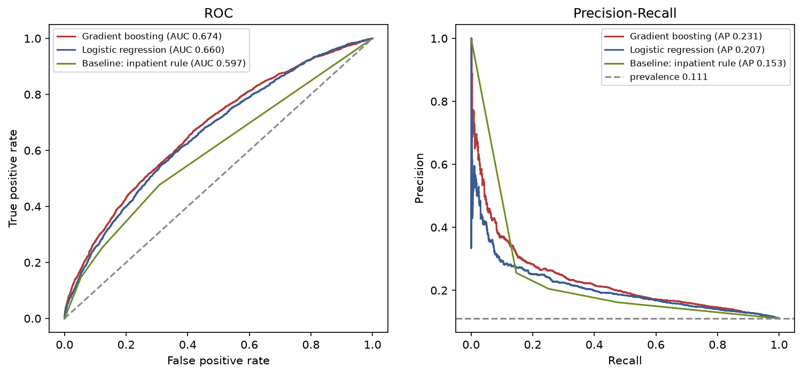
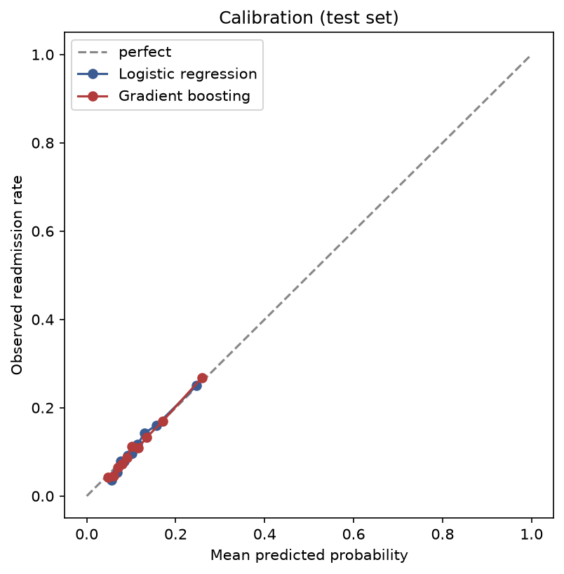

# Model report — predicting 30-day readmission (Diabetes 130-US)

Independent portfolio project. The aim is a methodologically honest pipeline — a
correctly defined cohort, no leakage, patient-level evaluation, honest comparison
with simple baselines, and calibrated probabilities — **not** a high ROC-AUC. All
figures below are reproducible via `python run_pipeline.py`.

## 1. Question

At the moment of discharge, estimate the probability that a patient with diabetes
is readmitted within 30 days (`readmitted == "<30"`). This is a descriptive /
predictive study on observational data, not a causal or clinical instrument.

## 2. Data and cohort

- **Source:** UCI *Diabetes 130-US Hospitals, 1999–2008* (id 296), 101,766
  encounters of 71,518 patients. Rows are **encounters, not patients**.
- **Target:** `y = 1` if `readmitted == "<30"`, else `0` (`">30"` and `"NO"` → 0).
- **Exclusions (frozen before modelling):** death/hospice discharge
  (`discharge_disposition_id ∈ {11,13,14,19,20,21}`, −2,423 encounters) and
  `gender = Unknown/Invalid` (−3). **Analytic cohort: 99,340 encounters / 69,987
  patients; 11,314 positives (11.39%).** See `docs/cohort_definition.md` and
  `reports/figures/exclusion_flow.png`.

## 3. Methods

- **Splitting:** patient-grouped hold-out `GroupShuffleSplit` by `patient_nbr`
  (80/20, seed 42); the test set is untouched until final evaluation. Inside train,
  `StratifiedGroupKFold` (5 folds) for tuning and threshold selection. Zero
  train/test patient overlap (`tests/test_leakage.py`).
- **Features:** demographics, admission/discharge, prior-year utilisation,
  diagnosis counts, ICD-9 diagnosis groups (Strack scheme, `src/features/
  icd9_groups.py`), medications, HbA1c. Never used: `encounter_id`, `patient_nbr`,
  `readmitted`/derived, `weight` (97% missing).
- **Preprocessing (fit on train folds only):** median imputation + standardisation
  (for logistic regression); one-hot encoding with rare-level grouping and safe
  handling of unseen categories; all inside a `ColumnTransformer`.
- **Models:** two baselines (constant train prevalence; prior-inpatient-visits
  rule), L2 logistic regression (`C` by CV), and `HistGradientBoostingClassifier`
  (early stopping, modest CV grid). ~11% positives kept **without** oversampling or
  class weights, so probabilities stay calibration-ready.
- **Evaluation:** ROC-AUC, PR-AUC, Brier, Cox calibration (intercept/slope) on the
  test set, with 95% CIs from a **patient-cluster bootstrap** (1,000 replicates).

## 4. Results (held-out test set — 19,658 encounters / 13,998 patients)

Positive rate 11.06%; the PR-AUC no-skill reference is 0.111.

| model | ROC-AUC | PR-AUC | Brier |
| --- | --- | --- | --- |
| Baseline: constant prevalence | 0.500 (0.500–0.500) | 0.111 (0.106–0.116) | 0.098 (0.095–0.102) |
| Baseline: prior-inpatient rule | 0.597 (0.583–0.611) | 0.153 (0.142–0.166) | 0.096 (0.093–0.100) |
| Logistic regression | 0.660 (0.646–0.674) | 0.207 (0.189–0.228) | 0.095 (0.092–0.098) |
| **Gradient boosting** | **0.674 (0.660–0.688)** | **0.231 (0.212–0.252)** | **0.094 (0.090–0.097)** |

**Model vs baseline (paired bootstrap ΔROC-AUC):** gradient boosting − inpatient
rule **+0.077 (0.067–0.087)**; logistic − inpatient rule +0.064 (0.053–0.074);
gradient boosting − logistic +0.014 (0.009–0.019). All CIs exclude 0.

**Calibration:** both models slightly over-predict risk — logistic intercept 0.168,
slope 1.097; gradient boosting intercept 0.173, slope 1.102 (ideal 0 / 1).

**Operating points (thresholds set on train CV, applied to test) — gradient boosting:**

| operating point | flagged per 1000 | sensitivity | specificity | PPV | NPV |
| --- | ---: | ---: | ---: | ---: | ---: |
| top 10% risk | 100.1 | 0.242 | 0.918 | 0.268 | 0.907 |
| top 20% risk | 196.8 | 0.393 | 0.828 | 0.221 | 0.916 |
| ~50% sensitivity | 274.3 | 0.488 | 0.752 | 0.197 | 0.922 |

At the top-20% operating point the model flags ~197 of every 1,000 discharges and
catches ~39% of true 30-day readmissions, with a precision of ~22% (confusion
matrix in `reports/evaluation_report.md`). This illustrates the inherent
precision ceiling at ~11% prevalence.

**Explainability.** The dominant predictors (permutation importance, gradient
boosting) are the number of prior inpatient visits and the discharge disposition,
followed by primary-diagnosis group; logistic odds ratios agree
(`reports/odds_ratios.md`). These are associations, not causal effects.

**Subgroups (robustness check, not a fairness audit).** ROC-AUC is broadly similar
across sex (~0.67) and the larger race and age groups; small subgroups are noisy.
Full table in `reports/evaluation_report.md`.

**Sensitivity analysis (one first encounter per patient, 13,998 encounters):**
gradient boosting ROC-AUC 0.663 (0.647–0.680), logistic 0.648 (0.631–0.664) —
consistent with the all-encounters analysis.

## 5. Limitations

See the README "Limitations" section: US data 1999–2008; no dates (encounter order
is an assumption); readmissions to other hospital networks are unobserved; high
missingness in some features; observational data (associations, not causation);
transportability to Germany/Europe unverified; no external or prospective
validation.

## 6. Conclusion

The models clearly beat the no-information baseline and **modestly** beat a simple
prior-inpatient-visits rule (ΔROC-AUC ≈ 0.08 with a CI excluding 0), with roughly
calibrated probabilities. For this dataset that is an honest, expected result. The
pipeline's value is its methodology — cohort definition, leakage control,
patient-level evaluation with cluster-bootstrap CIs, and calibration — not a
headline AUC. This is not a clinical tool and makes no claim of reducing
readmissions.
